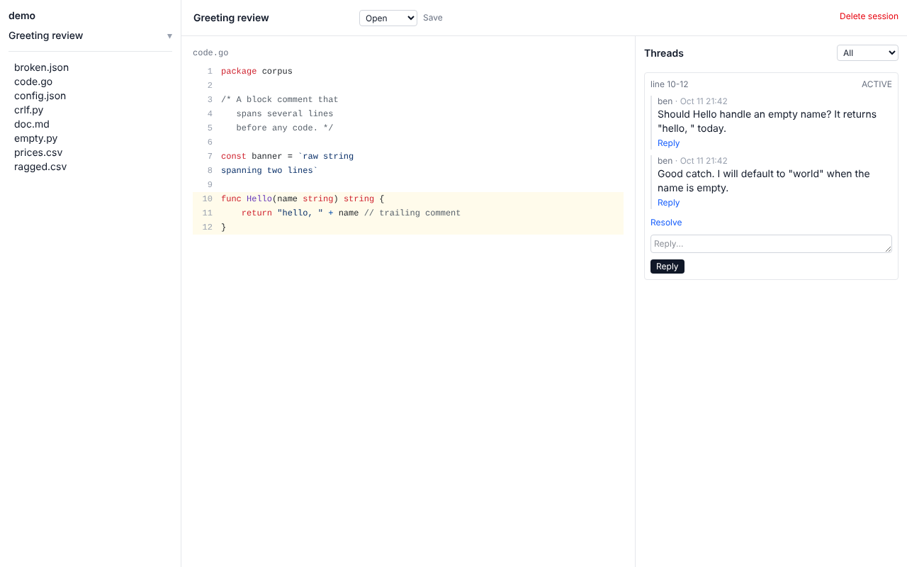

# Gloss

Async annotation and review for AI-generated content.

AI writes documents, code and data that are easy to review live in a
session and hard to review anywhere else. Gloss is the missing offline
layer: run `gloss .` against any directory and it boots a localhost web
UI plus an MCP server, backed by SQLite. Read files in your own time,
comment on specific lines, and feed those threads back to the AI over
MCP. No auth, no account, no internet connection required.



## How it works

1. The AI generates files in your repo.
2. You open Gloss later, read them, and comment on the lines that matter.
3. The AI reads the open threads over MCP and replies in context.
4. You continue the thread or resolve it. When the AI rewrites a file,
   threads re-anchor to the new text, or are marked orphaned. They never
   vanish.

## Install

Release binaries, a Homebrew tap and an install script are planned
([PLAN.md](PLAN.md), milestone 10) but not published yet. For now, build
from source. This needs Go 1.25+ and `make`:

```sh
git clone https://github.com/gloss-mcp/client.git
cd client
make build
./gloss --version
```

## Quickstart

```sh
cd path/to/your/project
gloss .
```

Gloss opens `http://localhost:4747`. Create a session, pick a file, click
a line (shift-click for a range) and write a comment.

To let Claude Code read and reply to your threads:

```sh
claude mcp add --transport http gloss http://localhost:4747/mcp
```

Flags: `-port` (default 4747, `0` for any free port), `-no-open`,
`-author` (name on your comments) and `-version`.

## Formats

Code (syntax highlighted), markdown (rendered and source), JSON, CSV
(cell-level anchors) and plain text. Image, audio, video and PDF support
is planned.

## Documentation

The docs site is built from [`site/`](site/): install, quickstart, MCP
setup and a plugin reference. The design references live in
[docs/data-model.md](docs/data-model.md) and
[docs/mcp-api.md](docs/mcp-api.md), and the delivery breakdown is in
[PLAN.md](PLAN.md).

## Development

`make` is the single entry point: `make run`, `make test`, `make lint`,
`make e2e`, `make build`, `make assets` and `make site`. See
[CLAUDE.md](CLAUDE.md) for conventions.

## License

[MIT](LICENSE)
